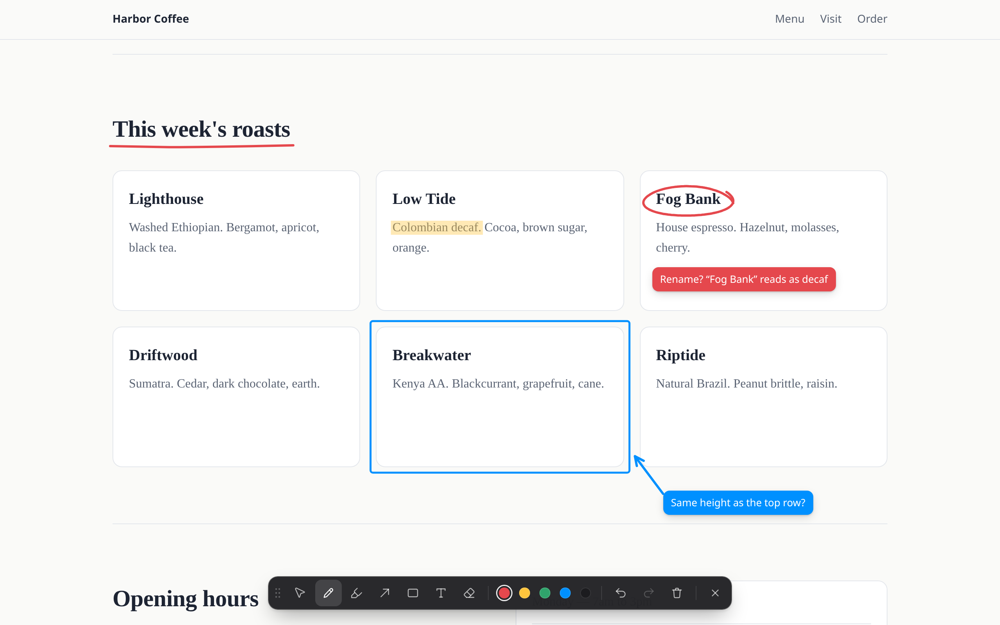

# Review Annotator

Draw and leave notes on any website during a site review. Your marks stay pinned to the page as you scroll.



## Install

**[Add to Chrome](https://chromewebstore.google.com/detail/igcjmdghfpkpfphbpbndllonafibgebk)** from the Chrome Web Store (the listing is under review and may not open yet).

Works in Chrome, Dia, Arc, Edge, Brave and other Chromium browsers.

To install from source: `npm install && npm run build`, then load the `dist/` folder unpacked from `chrome://extensions` with Developer mode on.

## Use

Press **`Alt+Shift+A`** (`⌥⇧A` on Mac) or click the extension icon to turn it on or off.

- **Tools:** pen, highlighter, arrow, box, text note, eraser
- **Colors:** five, on keys `1`–`5`
- **Undo, redo, and clear**
- **Use the page** (`V` or `Esc`) keeps your marks visible while you click and scroll normally.
- Drawings stay attached to the content when you scroll or resize, and they're saved per URL in your browser.

Each tool has a single-letter key, shown in its tooltip. To change the toggle shortcut, open `chrome://extensions/shortcuts`.

## Develop

```sh
npm install
npm run build    # bundle into dist/
npm run watch    # rebuild on change
npm run lint     # ESLint + type check
npm test         # end-to-end tests with the real extension in headless Chromium
npm run zip      # build and package dist/ as review-annotator.zip
npm run demo     # serve the test page at http://localhost:5178
```

The tests need Playwright's Chromium (`npx playwright install chromium`). [How it works](docs/how-it-works.md) explains the anchoring, storage and known limits.

## Privacy

Everything stays in your browser. There's no tracking, no analytics and no network requests. See [PRIVACY.md](PRIVACY.md).

## License

[MIT](LICENSE) © 2026 Launch Studio
